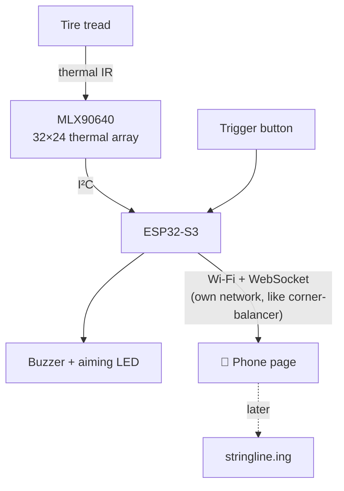

# Handheld Tire Temperature Scanner: Plan

Oct 14, 2026 · @jaimebuildsthings · Status: draft

**Contents:** [Goal](#goal) · [How it works](#how-it-works) · [Hardware](#hardware) · [Firmware](#firmware) · [Phases](#phases) · [Open questions](#open-questions)

## Goal

A cordless handheld that reads a tire's tread temperature **by zone** (outer, middle, inner) in one trigger pull, steps through all four corners, and sends the results to a phone, and later to [stringline.ing](https://stringline.ing) next to its alignment and corner-balance data.

It reads the surface with a thermal camera, so it works without touching the tire. Surface temperatures fall quickly after the car stops: scan within about a minute of coming in, always in the same order.

## How it works

1. Point at the tread from about 25 cm, centered with the aiming dot.
2. Pull the trigger. The device averages a few frames, finds the tire in the image, and splits the tread into zones.
3. A beep confirms. The phone shows the reading for that corner and moves to the next (LF → RF → LR → RR).
4. After four corners, the phone shows the full set: per-zone temps, the spread across each tire, and a CSV download.

**Reading the result:** a hotter inside edge means too much negative camber; a hotter middle means pressure too high; hotter edges mean pressure too low.

## Hardware

| Part | Why | ~Cost |
| --- | --- | --- |
| MLX90640 breakout, **55° field of view (BAA)** | Covers ~26 cm at 25 cm, so the whole tread with margin. Range −40 to 300 °C | $55–75 |
| ESP32-S3 DevKitC (N16R8) | Same board as corner-balancer; plenty of RAM for the sensor maths (~20 KB) | on hand |
| 1-cell LiPo, ~1000 mAh, + USB-C charger/protection board | Cordless | $10 |
| Momentary trigger button | Capture | $2 |
| Aiming aid: small laser dot module or bright LED | Center the sensor on the tread | $3–5 |
| Buzzer or vibration motor | "Captured" without looking | $2 |
| 3D-printed pistol-grip enclosure, **open aperture** in front of the lens | Glass and clear plastic block thermal IR | — |

Notes:
- **Laser safety:** use a low-power module and never point it at eyes.
- **Keep I²C short:** mount the sensor and the ESP32 in the same housing.
- **Emissivity:** tire rubber is about 0.95; make it a setting.

## Firmware

Same stack and conventions as corner-balancer: Rust, `esp-hal` + Embassy, host-tested `no_std` crates, Apache-2.0 code, and a phone page served on the device's own Wi-Fi.

| Piece | Notes |
| --- | --- |
| MLX90640 driver | Reads the EEPROM calibration, then converts frames to °C. Melexis's reference C driver is Apache-2.0; check Rust crates first (license!) before porting |
| `zones` crate (`no_std`, host-tested) | Find the tire in the frame (warm band vs. background), split it into 3 (or 5) zones, and average each zone's pixels over several frames |
| Capture flow | Trigger → average 4–8 frames → zones → beep → send. Next corner automatically |
| Phone page | Live thermal preview while aiming, per-corner results, spread per tire, CSV. Copy the corner-balancer web UI's patterns: captive portal, WebSocket, no-cache |
| Protocol | JSON lines like the scales protocol, e.g. `{"v":1,"type":"tire","corner":"LF","zones_c":[78.4,81.2,84.9],"t_ms":…}` |

Reuse from corner-balancer: the console, JSON frame style, web/portal code, and corner names (LF/RF/LR/RR). Shared crates could move into a common repo later; copying is fine to start.

## Phases

1. **Bench:** MLX90640 + ESP32-S3 on a desk. Serial console prints a 32×24 frame and zone temps. Check accuracy against a reference thermometer, a cup of hot water and a warm pan. *Gate:* zones within ±2 °C of a reference at 60–100 °C.
2. **Handheld prototype:** battery, trigger, buzzer, aiming aid, printed grip, and the phone page with the four-corner flow. *Gate:* a full four-tire scan in under 60 s after a drive, repeatable within ±2 °C.
3. **stringline.ing:** send results into stringline (USB/Web Serial first, then a link handoff or BLE), next to alignment and corner weights.
4. **Later, maybe:** a probe-pyrometer mode (K-type needle + MAX31856) for under-surface temps, or the on-car version (one sensor per wheel on the upright, ESP-NOW).

## Open questions

- 3 zones or 5? Pro pyrometers use 3; the array could do more.
- Phone page on the device's own Wi-Fi, or join the corner-balancer host's network so one phone page shows weights and temps?
- Rust MLX90640 driver: an existing crate (license?) or a port of Melexis's Apache-2.0 driver.
- Battery life target and sleep mode between scans.
