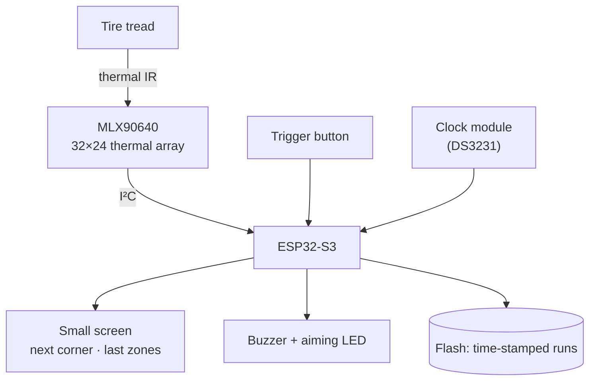

# Handheld Tire Temperature Scanner: Plan

Oct 14, 2026 · @jaimebuildsthings · Status: draft

**Contents:** [Goal](#goal) · [How it works](#how-it-works) · [Hardware](#hardware) · [Firmware](#firmware) · [Phases](#phases) · [Open questions](#open-questions)

## Goal

A cordless handheld that reads a tire's tread temperature **by zone** (outer, middle, inner) in one trigger pull, steps through all four corners, and **stores every reading on the device**, time-stamped, for review after the event and a revised alignment in [stringline.ing](https://stringline.ing).

**Designed for autocross:** between runs there's no time to connect a phone or upload anything. Pull up, scan four tires, go. Everything you need at the car is on the device: its screen shows which corner is next and what it read.

It reads the surface with a thermal camera, so it works without touching the tire. Surface temperatures fall quickly once the car stops: scan within about a minute of finishing a run, always in the same order.

## How it works

**At the car, between runs:**
1. **Long-press** the trigger to start a new run. The screen shows `Run 4 · LF ▸`.
2. Point at the LF tread from about 25 cm, centered with the aiming dot, and **pull**. The device averages a few frames, finds the tire in the image and splits the tread into zones.
3. A **beep**, then the screen shows the zones (`LF 78 81 85`) and moves to `RF ▸`. Repeat for RF, LR, RR.
4. After RR, the screen shows a one-line summary per tire and stores the run. Done; no phone involved.

**After the event:** the stored runs are reviewed for trends, and drive camber and pressure changes for the next alignment.

**Reading a tire:** a hotter inside edge means too much negative camber; a hotter middle means pressure too high; hotter edges mean pressure too low.

## Hardware

| Part | Why | ~Cost |
| --- | --- | --- |
| MLX90640 breakout, **55° field of view (BAA)** | Covers ~26 cm at 25 cm, so the whole tread with margin. Range −40 to 300 °C | $55–75 |
| ESP32-S3 DevKitC (N16R8) | Same board as corner-balancer. 16 MB flash holds thousands of runs | on hand |
| **Small screen**: 0.96″ OLED (SSD1306, I²C) or 1.14″ color TFT (ST7789, SPI) | Next corner and last reading, readable in sunlight (OLED: high contrast; TFT: color zones) | $5–8 |
| **Clock module, DS3231** | Real timestamps on every run, kept on a coin cell while the device is off | $5 |
| 1-cell LiPo, ~1000 mAh, + USB-C charger/protection board | Cordless, lasts an event day | $10 |
| Momentary trigger button | Pull = capture; long-press = new run | $2 |
| Aiming aid: small laser dot module or bright LED | Center the sensor on the tread | $3–5 |
| Buzzer or vibration motor | "Captured" without looking | $2 |
| 3D-printed pistol-grip enclosure, **open aperture** in front of the lens, window for the screen | Glass and clear plastic block thermal IR | — |

Notes:
- **Laser safety:** use a low-power module and never point it at eyes.
- **Keep I²C short:** sensor, screen, clock and ESP32 all in one housing.
- **USB-C for flashing:** the enclosure exposes the ESP32-S3 DevKit's UART/COM USB-C port (behind a cover) for firmware updates and the serial console. The charger board's USB-C is separate, for charging.
- **Emissivity:** tire rubber is about 0.95; make it a setting.

## Firmware

Same stack and conventions as corner-balancer: Rust, `esp-hal` + Embassy, host-tested `no_std` crates, Apache-2.0 code.

| Piece | Notes |
| --- | --- |
| MLX90640 driver | Reads the EEPROM calibration, then converts frames to °C. Melexis's reference C driver is Apache-2.0; check Rust crates first (license!) before porting |
| `zones` crate (`no_std`, host-tested) | Find the tire in the frame (warm band vs. background), split it into 3 (or 5) zones, and average each zone's pixels over several frames |
| Capture flow | Trigger → average 4–8 frames → zones → beep → show → store → next corner. Long-press starts a new run |
| **Run log** (host-tested record format) | Append-only log in a dedicated flash partition (like corner-balancer's `calib`, but larger). One record per corner reading: run number, corner, zones and clock time. Survives power-off and firmware updates |
| Screen UI | Big text: run number, next corner, last zones. Battery level. Nothing to navigate at the car |
| Record format | Same JSON-lines style as the scales protocol, e.g. `{"v":1,"type":"tire","run":4,"corner":"LF","zones_c":[78.4,81.2,84.9],"time":"2026-10-18T10:42:07"}` |

Reuse from corner-balancer: the console, the two-slot crash-safe flash record, the JSON frame style, and corner names (LF/RF/LR/RR).

## Phases

1. **Bench:** MLX90640 + ESP32-S3 on a desk. Serial console prints a 32×24 frame and zone temps. Check accuracy against a reference thermometer, a cup of hot water and a warm pan. *Gate:* zones within ±2 °C of a reference at 60–100 °C.
2. **Handheld prototype:** battery, trigger, screen, clock, buzzer, aiming aid, printed grip, run log. *Gate:* a full four-tire scan in under 60 s after a drive, repeatable within ±2 °C, all runs still stored with correct times after a power cycle.
3. **Later, maybe:** getting runs into stringline, a probe-pyrometer mode (K-type needle + MAX31856) for under-surface temps, or the on-car version (one sensor per wheel on the upright, ESP-NOW).

## Open questions

- 3 zones or 5? Pro pyrometers use 3; the array could do more.
- OLED (contrast, cheap) or color TFT (zones shown as colors)?
- Rust MLX90640 driver: an existing crate (license?) or a port of Melexis's Apache-2.0 driver.
- Battery life target and sleep mode between scans.
