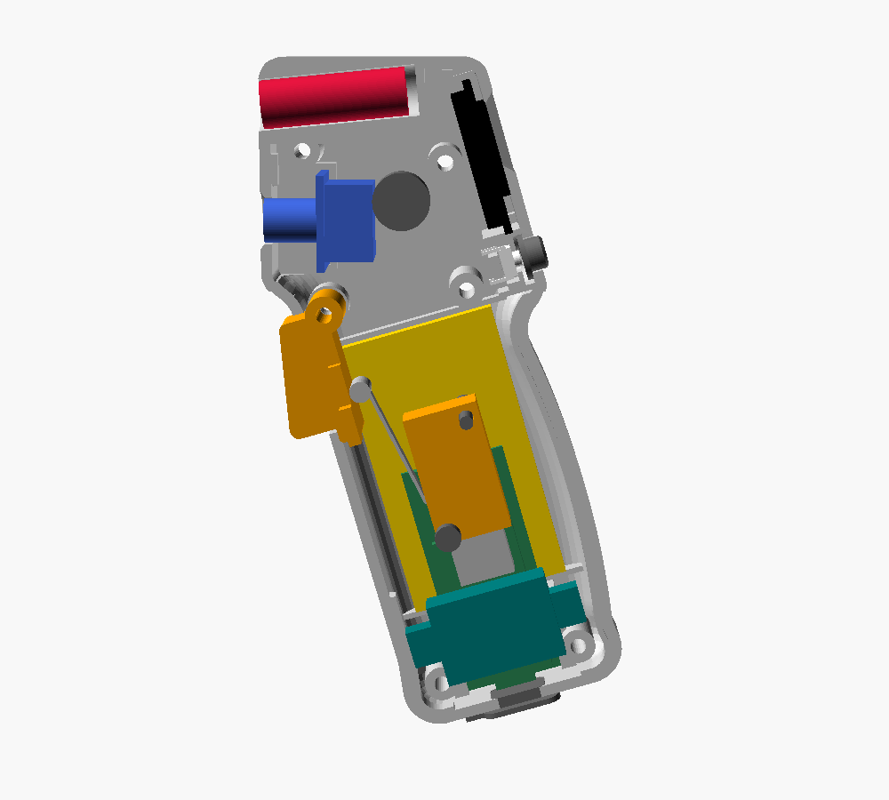
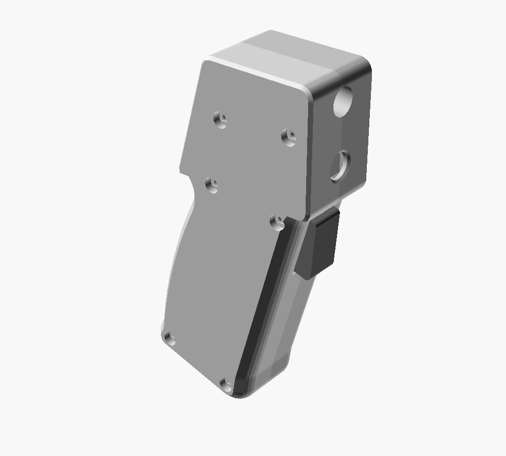
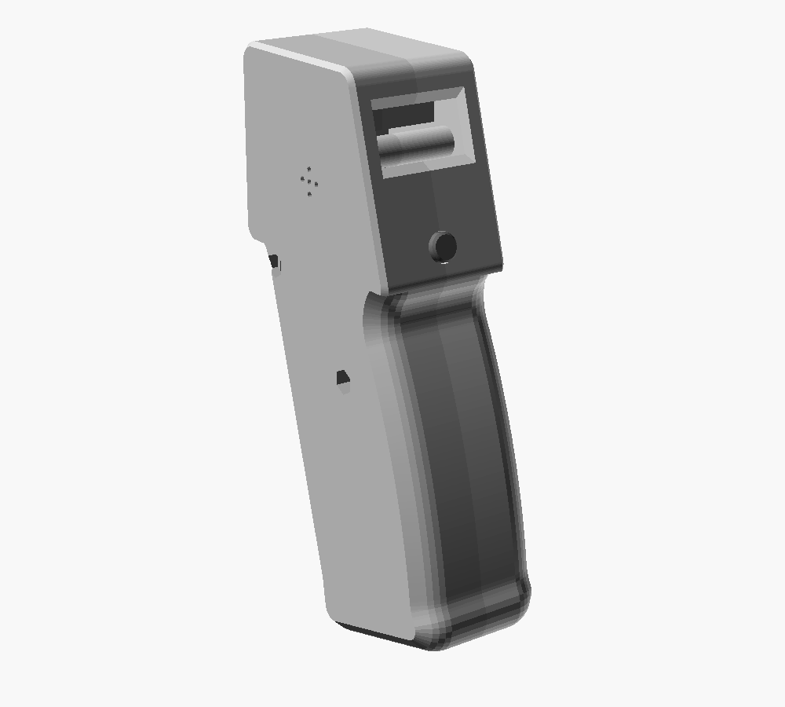
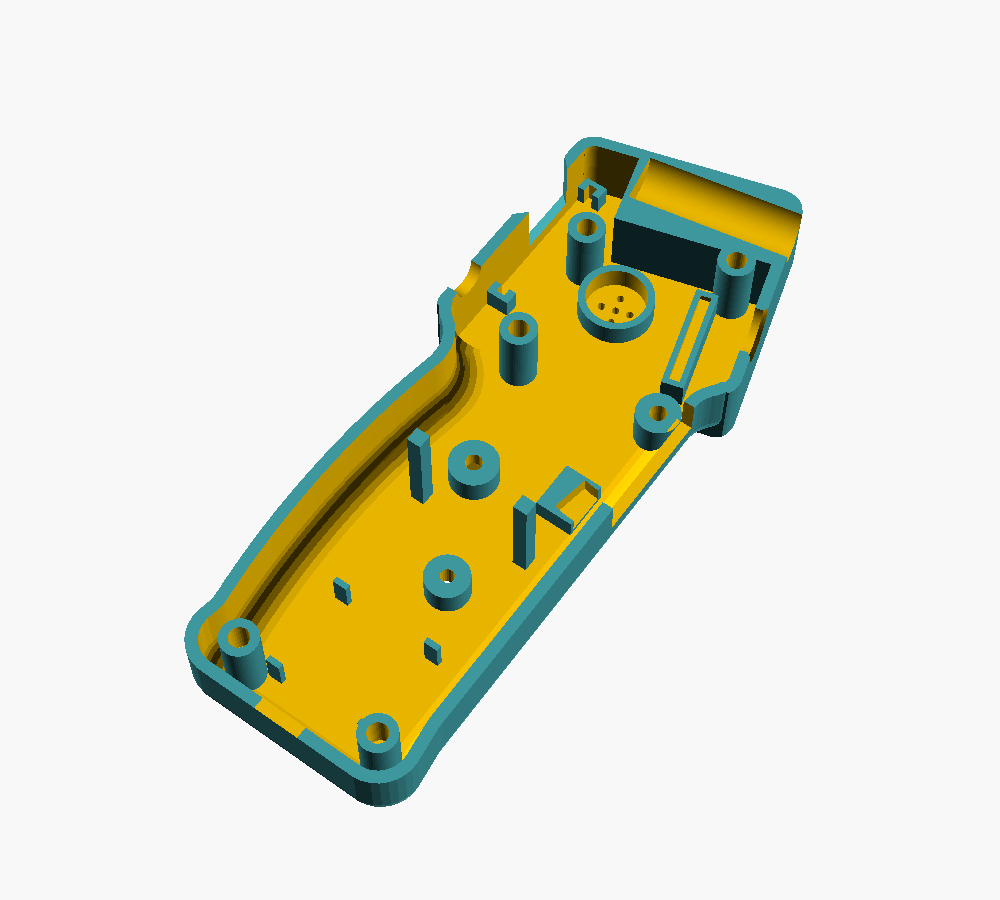

# Enclosure (phase 2 prototype)

A pistol-grip shell for the handheld scanner in [docs/plan.md](../../docs/plan.md). It is a parametric [OpenSCAD](https://openscad.org) model, [`enclosure.scad`](enclosure.scad), split down the middle into two halves that print flat without supports and screw together.



| Front: aperture and aiming dot | Rear: screen and menu button |
| --- | --- |
|  |  |

About 78 × 145 × 35 mm overall. The head is short and tall (61 mm long at the bottom, 47 at the top, 49 tall) with square edges. Its rear face leans forward 16°, in line with the grip, so the screen faces up toward you while you aim down at a tire; the face overhangs the grip by 7 mm, so your hand's web stops under it. Version 0.4 is resized to the measured parts. Version 0.2, with a long head and the screen on top, is kept as the `v0.2-enclosure` tag.

The grip is shaped for the hand:

- **Length:** 88 mm below the head (`grip_l`), for four fingers of a medium to large hand.
- **Section:** 47 × 35 mm, with its long edges rounded at 8 mm (`edge_r`), so it's close to an oval. The rounding finishes in a 45° bevel at each print bed, so the halves still print without supports, and the inside follows it so the wall stays 2.4 mm.
- **Palm swell:** the backstrap bulges 3 mm where your palm sits (`swell`, `swell_v`).
- **Flared butt:** the bottom widens 3 mm at the back and 2 mm at the front (`flare`, `flare_l`), so the device doesn't slide out of your hand.

The sensor looks out through an **open aperture**: there's no window, because glass and clear plastic block thermal IR.

## Layout

| Where | What |
| --- | --- |
| Head, front | MLX90640 (bare TO39) seated flush on a 20 mm perfboard carrier, its lens 1 mm behind the front face; the carrier's edges slide into rails |
| Head, front top | Laser bore, tilted so the dot lands on the sensor axis 250 mm out (`aim_dist`) |
| Head, rear face | 0.96″ OLED behind a bevelled window, header at the top. Four corner slots hold it: it slides sideways into the left half's two, and the right half's two close over its other corners. No glue, so it comes out when the case is open |
| Head, rear face, below the screen | Menu button: a 6 mm tactile button behind a printed cap, under the thumb. It sits in a holder on the left half, with its legs out the back past a backstop bar |
| Head, right wall | Piezo buzzer, with sound holes |
| Grip, front top | Printed trigger: a 14 mm wide paddle, centred, filling an opening at the top of the grip's front, just under the head, hinged at its top on an M3 screw. Its back face presses the roller of a standard-size lever microswitch, which pushes it back out. At rest the roller is pressed in 0.5 mm (`sw_preload`); a full pull moves it another 3.1 mm (`sw_pull`): 0.9 mm past the click, 0.5 mm short of where the lever bottoms out. That's biased toward overtravel, because a switch that never clicks is worse than one that bottoms. The bottom of the paddle swings in about 4.8 mm. A shoulder below the opening is the rest stop; an 8 mm tall ear on the paddle's right side meets a post on the right wall at full pull. Inside the grip, the paddle reaches 3 mm further right (`trig_pad`) so all of the 7.75 mm roller bears on it; the part you pull stays centred |
| Grip, centre right | The microswitch, upside down (terminals at the bottom, roller up at the trigger), beside the Feather's low top end (its end stops 1.6 mm short of the Feather's STEMMA QT sockets), its roller 4.5 mm right of centre. It sits on two posts off the right wall: an M3 × 16 screw and nut clamp it through one hole, and an M3 × 14 screwed in from outside is a steel locating pin through the other |
| Grip, left wall | 1200 mAh LiPo, from just under the head down, between two stops |
| Grip, middle | FeatherS3[D], standing on its edge with its parts facing the clock, between the battery and the clock. Below the battery, rails on the left half hold its long edges; two posts on the right half stop its top end, so a USB plug can't push it up the grip |
| Grip, butt | The Feather's USB-C (charging, firmware, serial console) behind a press-fit cover. It's the only port |
| Grip, right wall, low | DS3231 clock board lying across the grip, below the switch's wires, between four stops on its long edges, with room for a STEMMA QT plug at each end. It sits 0.7 mm off the wall on foam tape, so its corners clear the grip's rounded inside edges |

## Wiring

The I²C parts chain on STEMMA QT cables: Feather → clock → screen, and the sensor carrier on the Feather's second port.

- **Sensor carrier:** a STEMMA QT to male-header cable (Adafruit 4209), its pins soldered into the perfboard.
- **Clock:** a plug-to-plug cable (Adafruit 4210) from the Feather.
- **Screen:** the board's STEMMA QT sockets point sideways, and the head has no room for a plug beside the screen. Instead, cut one plug off a **200 mm** STEMMA QT cable (100 mm doesn't reach: the clock is low in the grip, about 110 mm away in a straight line) and solder its wires to the screen's header holes: **Vin** (red), **GND** (black), **Data** = SDA (blue), **Clk** = SCL (yellow). Plug the other end into the clock's second socket.
- **Menu button:** wire two diagonally opposite legs, so you get the switch whichever way round it goes in. One goes to GND, the other to a free GPIO that can wake the board (GPIO 1–21). Trim the other two legs.
- **Feather:** solder the switch, menu button, buzzer and laser wires from the top (the side facing the clock) and trim the leads flush underneath, because the board sits close to the battery and the rails hold its long edges (0.8 mm, `fth_edge`). The sensor's 150 mm cable reaches from the head down to the Feather. Run the switch's wires straight down to the Feather's rear-edge pins, not past the clock: the lower grip is crowded. The clock's cables bend 90° right at the plug, so the 8 mm between each end of the clock and the wall is plenty.

## Measure your parts first

Measure your actual parts with calipers and update the `/* [Parts] */` block before printing. Width and clearance changes ripple through the layout, so re-run the check afterwards (see [Changing the model](#changing-the-model)).

The values below were measured with 0.05 mm vernier calipers on the parts for the first build. Yours may differ, especially the switch and the laser, which come in several sizes under the same names.

| Parameter | Measured | Check on yours |
| --- | --- | --- |
| `car`, `car_back`, `mlx_can_d`, `mlx_can_h` | 20 × 20 × 1.6 mm carrier; sensor can Ø9.4, 11.4 mm tall to the lens, 6 mm legs (so it sits flush) | The can's height |
| `fth`, `fth_top_h`, `fth_bot_h`, `usb_y` | 51.4 × 22.9 × 1.1 mm board, 6.7 mm overall at the battery plug, no parts underneath, USB-C centred and 1.6 mm past the end; STEMMA QT sockets from 16 mm below the antenna end, 5.5 mm overall (`fth_zones`) | Part heights near the antenna end, where the switch sits beside the board |
| `oled_pcb`, `oled_glass`, `oled_win_ds` | Adafruit 326: 29.5 × 31.7 mm board, 3.3 mm to the glass front, 6.4 mm with the sockets; glass 26.7 × 19.25 mm, 5 mm below the header edge | Where the active area sits: power the screen and measure the lit pixels |
| `rtc` | Adafruit 5188: 25.85 × 17.75 mm, 7.95 mm thick with the coin cell and sockets | |
| `bat` | Adafruit 258: 34.65 × 61.6 × 5 mm (5.5 allowing for swelling) | |
| `laser_d`, `laser_l` | Adafruit 1054: 10.1 mm tube, 30.25 mm long | Both: smaller modules exist |
| `buzzer_d`, `buzzer_h` | Adafruit 160 (PS1240): 11.8 mm, 6.55 mm tall | |
| `btn`, `btn_stem` | 6 mm tactile button: 6.1 mm square body, 2.7 mm tall, 3.5 mm stem 1.5 mm above it | Body height: it sets where the cap meets the stem |
| `sw`, `sw_holes`, `sw_roller`, `sw_click` | Adafruit 819: 28 × 15.95 × 9.85 mm body, Ø3.2 holes at opposite corners; roller Ø4.5 × 7.75 mm wide, 9.65 mm off the lever side and 8.25 mm past the far end; clicks after 2.7 mm, bottoms out at 4.1 mm | **All of it.** The trigger is laid out around the roller's position and travel |

## Printing



| File | Notes |
| --- | --- |
| [`stl/enclosure-left.stl`](stl/enclosure-left.stl) | Counterbored screw holes, alignment lip, battery stops, Feather rails, menu button holder, OLED corner slots |
| [`stl/enclosure-right.stl`](stl/enclosure-right.stl) | Heat-set insert holes, switch posts, trigger stop, Feather stops, buzzer ring, clock stops, OLED corner slots |
| [`stl/usb-cover.stl`](stl/usb-cover.stl) | Press-fit cover for the USB opening |
| [`stl/trigger.stl`](stl/trigger.stl) | Trigger, printed on its side with the stop ear on top. If it rubs in its opening, sand its sides lightly |
| [`stl/button-cap.stl`](stl/button-cap.stl) | Menu button cap, printed flange down |
| [`stl/test-trigger.stl`](stl/test-trigger.stl) | **Test print first:** the right half's grip top (about 67 × 76 × 18 mm): hinge, switch posts, trigger stop. With the trigger and the switch on it, check that the switch clicks at full pull and doesn't bottom out |
| [`stl/test-laser.stl`](stl/test-laser.stl) | **Test print first:** a 12 mm slice of the laser bore. The laser should slide in snugly |

- The STLs are already oriented: flat outer face down, open side up. No supports, no brim needed.
- PETG or ASA is best, since a car at an event sits in the sun and PLA softens around 55 °C. PLA is fine for a first fit check.
- 0.2 mm layers, 3–4 perimeters, 20 % infill. Each half is about 78 × 145 mm.
- The screw counterbores and the two nut pockets have two stepped bridging layers built in, so they print without support. Drill or cut them out if your slicer leaves a skin.
- Print `test-trigger` and `test-laser` before the halves (about an hour). If the switch doesn't click at full pull, sand the stop post's face; if the lever bottoms out first, add tape to it. Then change `sw_pull` to match before printing the halves.
- Print the trigger with 4 perimeters or 100 % infill: its stop ear takes the full squeeze across its layers.
- The Feather stops (3 × 3 mm) on the right half stand 25 mm off the bed. Print them slowly, or bump the infill so they come out solid.
- If the cover is too tight or too loose, change `usb_cover_fit` and reprint just the cover.

## Hardware

- 5 × M3 × 20 socket head screws, plus 1 × M3 × 30 and an M3 nut for the trigger hinge, 1 × M3 × 16 and an M3 nut for the switch, and 1 × M3 × 14 as the switch's locating pin
- 5 × M3 heat-set inserts, about 4 mm OD × 5.7 mm long, pressed into the right half (`insert_d`, `insert_depth`)
- Foam tape for the battery and the clock board; 0.5 mm thick or less for the battery, since it sits 2 mm from the trigger

## Assembly

1. Press the heat-set inserts into the right half.
2. Wire the switch's **COM** (the bent tab on the side opposite the lever; leave it as it is) and **NO** (the end tab nearer that side). Cut the NC end tab off and trim the NO tab to about 7 mm past the body with flush cutters, then solder the wires and cover the joints with heat-shrink. Put a nut in each pocket on the right half's outer face (the switch's sits deeper). Hold the microswitch on its posts in the right half (it overhangs the split by half a millimetre), terminals down and roller up toward the trigger. Screw the M3 × 14 in from outside through the post and the switch's hole near the terminals (it self-taps into the post), then clamp the switch with the M3 × 16 through its other hole into the nut. Plug both cables into the clock and bend each one sharply just past its plug, toward the middle of the grip (away from the wall); then stick the clock board to the right wall between its stops on foam tape, and the buzzer into its ring.
3. Drop the button cap into its hole in the left half's rear wall from the inside, flange inward, then slide the menu button into its slot behind it, legs pointing up and down. A dab of glue keeps the button in its slot while you work. Push the laser into its bore (a dab of glue holds it). Cut the sensor carrier to 19.5–20 mm and file its edges so it slides into its rails. Slide the OLED sideways into the two corner slots on the left half, glass toward the window. Stick the battery to the left wall between its stops, then slide the Feather into its rails over it, parts up and USB-C into the opening in the butt.
4. Fit the trigger into its opening, holding the switch's lever back as it drops in, and wire everything (see [Wiring](#wiring)). Keep the I²C runs short.
5. Close the halves (the lip on the left half locates the right) and screw them together. The M3 × 30 goes through the trigger's hinge, into the nut recessed in the right side.

The OLED's header ends up at the rear, so the image will be upside down unless the firmware rotates it 180°. The SSD1306 can do that with a register setting.

## Changing the model

Open `enclosure.scad` in OpenSCAD and press **F5** to preview. Use the `part` setting (or the Customizer panel) to switch between the `assembly`, `cutaway`, `left`, `right`, `usb_cover`, `trigger`, `btn_cap`, `test_trigger` and `test_laser` views; `pull` (0 to 1) swings the trigger. Then export:

```sh
openscad --export-format binstl -D 'part="left"'      -o stl/enclosure-left.stl  enclosure.scad
openscad --export-format binstl -D 'part="right"'     -o stl/enclosure-right.stl enclosure.scad
openscad --export-format binstl -D 'part="usb_cover"' -o stl/usb-cover.stl       enclosure.scad
openscad --export-format binstl -D 'part="trigger"'   -o stl/trigger.stl         enclosure.scad
openscad --export-format binstl -D 'part="btn_cap"'   -o stl/button-cap.stl      enclosure.scad
openscad --export-format binstl -D 'part="test_trigger"' -o stl/test-trigger.stl enclosure.scad
openscad --export-format binstl -D 'part="test_laser"'   -o stl/test-laser.stl   enclosure.scad
```

`part="check"` is the fit check: it renders where the stand-in parts overlap the shell and where the two halves overlap each other. A clean design leaves only zero-thickness contact faces, such as boards resting in their slots. Run it after any layout change.

To try a different grip length, change `grip_l` and re-run the check. The switch's wires and the clock fill the grip down to the Feather's USB end, so a shorter grip needs a new layout. Below about 85 mm, a large hand's little finger hangs off the end anyway. `rear_tilt` sets how far the screen leans back, and `rear_x` the overhang over your hand.

## Open questions

- **Grip feel.** The length, section and swell are from typical hand sizes. Print one in PLA and hold it before printing the real one: `grip_l`, `grip_angle`, `swell` and `flare` are the knobs. `grip_d` and `edge_r` are tied to the battery's width: rounder edges need a deeper grip.
- **Screen angle.** The rear face leans 16°, in line with the grip. Hold the print at a tire and check that you can read the window; `rear_tilt` changes it.
- **A full grip.** Battery, Feather, clock and switch share the grip, with the wires from the head running down past them. The switch's end tabs stick out 10.6 mm, too far for the 10 mm the model leaves below the switch (`sw_term`) before the clock, so the NO tab gets trimmed to 7 mm and the unused NC tab cut off. COM comes out of the switch's back, toward the back of the grip, where there's room (`sw_com`). Check there's room for the wiring before printing in PETG.
- **Menu button reach.** It's where the thumb lands when it reaches over the back of the head. If that's awkward, `btn_s` moves it up or down the rear face (the screen sits right above it).
- **Trigger feel** depends on the microswitch's roller lever, and the pull is longer than v0.3's (about 4.8 mm at the bottom of the paddle). If the lever is too light to return the trigger, add a small compression spring behind the paddle. `sw_roll_v` and `sw_pull` set the pull.
- **Weather.** The open aperture and sound holes let dust in. A thin IR-transparent film over the aperture (germanium, or a thin polyethylene film) would need testing before use.
