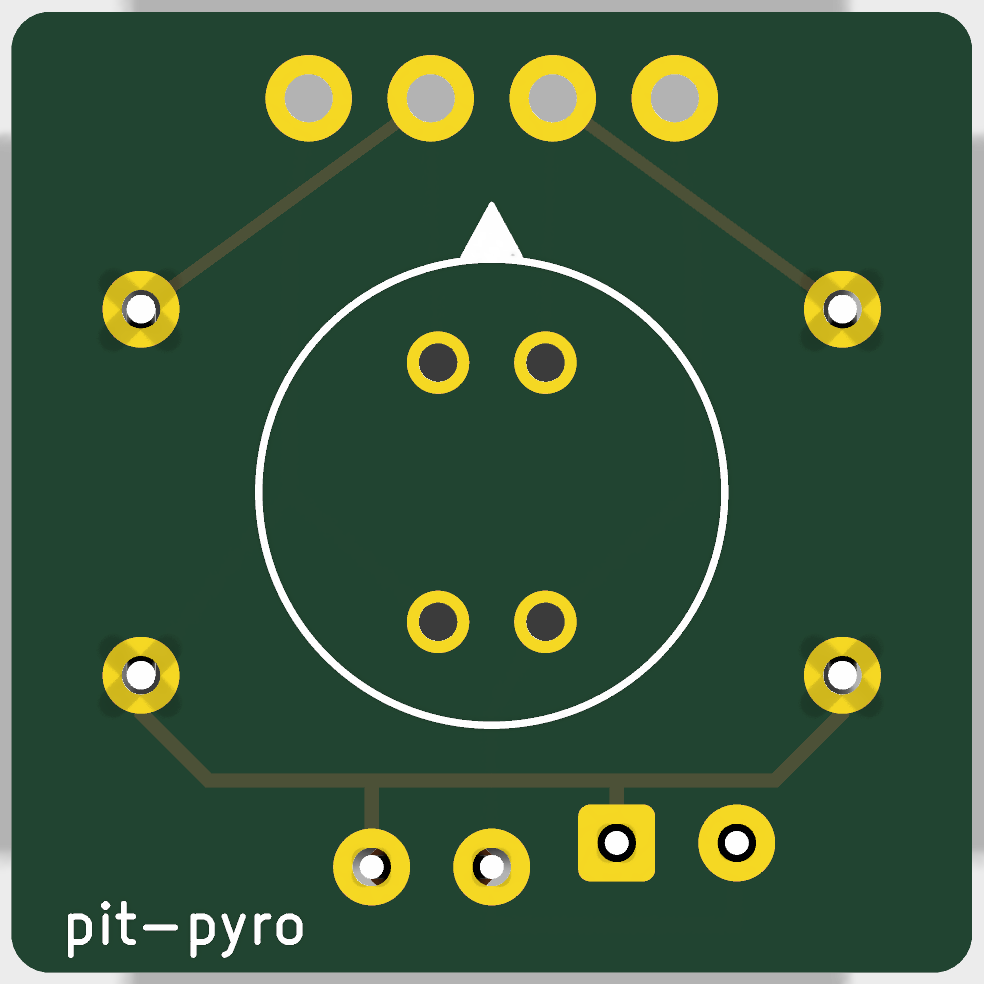
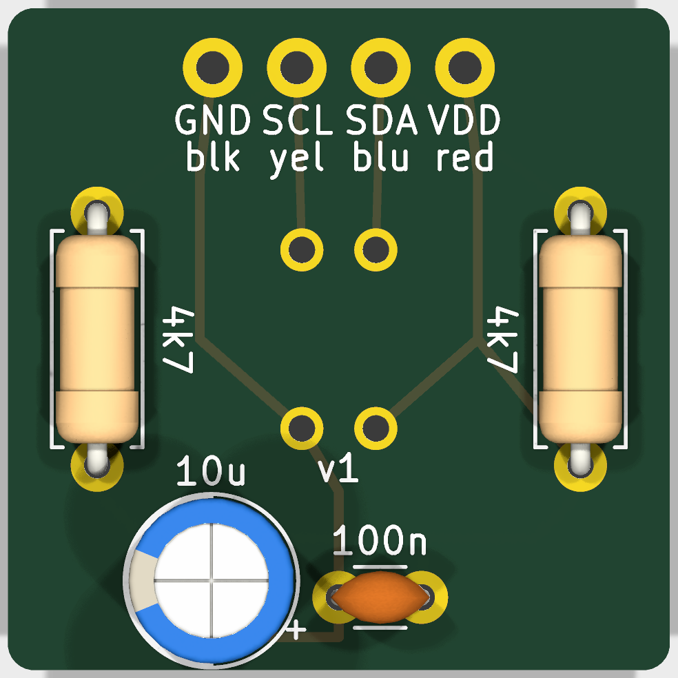

# Sensor carrier

A 20 × 20 mm two-layer PCB for the bare MLX90640 (TO39 can). It replaces the perfboard square: the holes match the sensor's legs, the pull-ups and supply capacitors are on the board, and it fits the enclosure head's carrier rails as is.

| Front (sensor side) | Back (parts side) |
| --- | --- |
|  |  |

## Order

Upload [`fab/sensor-carrier-v1-gerbers.zip`](fab/sensor-carrier-v1-gerbers.zip) to any PCB maker (JLCPCB, PCBWay, OSH Park). The defaults are right: 2 layers, 1.6 mm, 1 oz copper, any colour, HASL or ENIG. Five boards usually cost a few dollars; express shipping is what makes it fast.

## Parts

| Ref | Part | Notes |
| --- | --- | --- |
| U1 | MLX90640ESF-BAA (55°, bare TO39) | Front side, flush. Tab toward the triangle on the silkscreen |
| R1, R2 | 4.7 kΩ, axial, 7.62 mm lead spacing | I²C pull-ups (SDA and SCL to VDD) |
| C1 | 100 nF ceramic, 2.5 mm lead spacing | Supply decoupling, next to the pins |
| C2 | 10 µF electrolytic, up to Ø5 mm, 2.5 mm lead spacing | **Stripe (−) on the hole without the square pad.** Lay it over if it's taller than about 10 mm |
| J1 | Four wires | Cut the male pins off a STEMMA QT cable (Adafruit 4209). Wires go in from the back and are soldered on the front |

## Pins

The sensor's legs aren't in a square: they sit on a Ø5.84 mm circle in two pairs 45° apart (datasheet Figure 27). SDA and SCL are either side of the tab; VDD and GND face them.

| Hole (back label) | Wire | Sensor pin |
| --- | --- | --- |
| VDD | red | 2 |
| SDA | blue | 1 |
| SCL | yellow | 4 |
| GND | black | 3 |

## Assembly

1. **Resistors and capacitors first,** bodies on the back, soldered on the front. That way the sensor never sees their heat.
2. **The sensor,** from the front, flush, tab toward the triangle. Solder each leg quickly, one at a time.
3. **The wires,** in from the back, soldered on the front.
4. Before power, check with a meter: no beep between any two wires; SDA–VDD and SCL–VDD about 4.7 kΩ; in diode mode, + on GND and COM on SDA reads one diode drop (~0.6 V).
5. Plug into the Feather's STEMMA QT port 2 (I2C2). See [docs/desk-test.md](../../docs/desk-test.md).

Keep everything on the back within about 12 mm of the board and 1 mm in from its left and right edges, where the head's rails grip it.

## Changing the board

The board is generated by [`generate.py`](generate.py): every position is in that file. With KiCad 10 installed:

```sh
cd hardware/sensor-carrier
/Applications/KiCad/KiCad.app/Contents/Frameworks/Python.framework/Versions/Current/bin/python3 generate.py
kicad-cli pcb drc sensor-carrier.kicad_pcb          # expects only the two "footprint library" notes
kicad-cli pcb export gerbers --layers F.Cu,B.Cu,F.Silkscreen,B.Silkscreen,F.Mask,B.Mask,Edge.Cuts --no-x2 -o fab/ sensor-carrier.kicad_pcb
kicad-cli pcb export drill --format excellon --excellon-separate-th -o fab/ sensor-carrier.kicad_pcb
```

Then zip the exported files into `fab/` in place of the old zip. `sensor-carrier.kicad_pcb` opens in KiCad for a look; the two custom footprints (the sensor and the wire holes) live in the board file, so KiCad notes they aren't in a library.

Licensed CERN-OHL-P-2.0, like the rest of [`hardware/`](../LICENSE).
